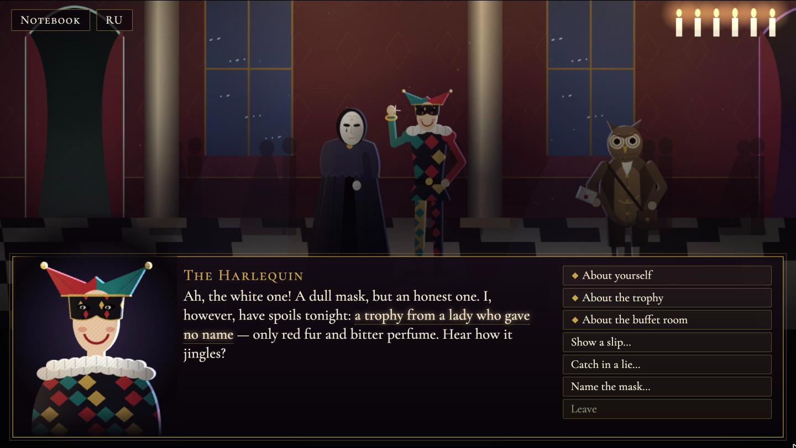

# The White Mask (Белая маска)

A short detective prototype set at a St. Petersburg masquerade. A woman has been poisoned and the hand that did it is known. The Devil sends you, the White Mask, to find out who guided that hand.

[](https://iansilent.github.io/white-mask/)

**[▶ Play in the browser](https://iansilent.github.io/white-mask/)** · keyboard or mouse · 5–10 minutes · English and Russian

## The loop

1. Walk between four rooms and talk to five masked guests. Nobody speaks plainly.
2. Glimmering phrases in their speech are **slips**. Click one to write it into the notebook.
3. Show a slip to another mask to get a reaction.
4. Catch a mask in a lie: pick one thing it has said and a slip that contradicts it. A caught mask lets slip who another mask really is. A wrong accusation costs a candle.
5. Name a mask: pick a name from the Devil's list (seven names for five masks) and a slip in which someone else speaks of that mask. A wrong name costs a candle too. There are six.
6. A right name drops you both into the Underside, a red, backwards version of the room, where that person confesses what they did and why.
7. Return to the mirror. The Devil asks three questions, each answered with a name.

## Design pillars

- A dialogue system built on what people let slip, not on what they say.
- Everyone wears a mask and may lie while it is on. The truth costs a risk.
- The poisoner is known from the first minute. The question is who led him to it, and he is not excused.
- A small occult layer: the Devil in the mirror and the Underside.

## Controls

`A` / `D` or arrows to walk, `E` to talk or use a door, `Tab` for the notebook, `1`–`9` to pick a dialogue option. Mouse clicks work for everything.

## Tech

Canvas and vanilla JavaScript, no build step, no dependencies, no image assets: every mask, figure and room is drawn in code.

- `index.html` — page and styles
- `story.js` — the whole case and every line, in both languages
- `game.js` — rooms, walking, masks and faces, dialogue logic, the Underside
- `figures.js` — full-height figures with arms, props and their own light
- `portraits.js` — the animated busts shown in dialogue
- `light.js` — pools of light, shadows, floor reflections, dust
- `depth.js` — blurred foreground, haze, parallax

To run locally, open `index.html`, or serve the folder without caching:

```bash
python3 serve.py 8792
```

Review pages: `index.html?review` shows every portrait in every state, `index.html?figures` shows every figure.
